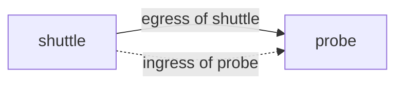

# The Subject And The Direction

Every Cilium policy answers two questions before it answers anything else. Which endpoints does the policy apply to, and for which direction of traffic? If you misread either answer, you will misread every rule below it. This part teaches how to find both answers in the YAML.

An endpoint is the Cilium name for a network interface of a pod, together with its labels and its security identity. In Kubernetes, one pod normally has one endpoint. The Cilium agent, a program that runs on every node as the DaemonSet `cilium` in `kube-system`, creates the endpoint when the pod starts. The agent also loads the policy rules for that endpoint into the Linux kernel.

## A first policy

Look at this policy before reading the rules. It is a complete CiliumNetworkPolicy. The API version `cilium.io/v2` and the kind `CiliumNetworkPolicy` tell the Kubernetes API server which custom resource definition to use.

```yaml
apiVersion: cilium.io/v2
kind: CiliumNetworkPolicy
metadata:
  name: probe-from-shuttle
  namespace: starfleet
spec:
  endpointSelector:
    matchLabels:
      app: probe
  ingress:
  - fromEndpoints:
    - matchLabels:
        app: shuttle
    toPorts:
    - ports:
      - port: "8080"
        protocol: TCP
```

Read it from the top. The policy lives in the namespace `starfleet`. It applies to endpoints that carry the label `app: probe`. It has an `ingress` section, so it describes traffic that arrives at those endpoints. The one ingress rule allows connections from endpoints labelled `app: shuttle`, and only to TCP port 8080.

## The endpointSelector names the subject

The `endpointSelector` field selects the endpoints that the policy governs. This group is the subject of the policy. Its syntax is the standard Kubernetes label selector, so it supports `matchLabels` and `matchExpressions`.

The selector never names the other side of a connection. In the policy above, `app: probe` is the subject. The endpoints with `app: shuttle` are the peer. People often mix these two up, because both are written as labels. The position in the YAML decides the role: the `endpointSelector` is the subject, and a selector inside `fromEndpoints` or `toEndpoints` is the peer.

A namespaced CiliumNetworkPolicy can only select endpoints in its own namespace. Kubernetes does not allow a namespace in the `endpointSelector`, because that would let one namespace change the traffic of another. An empty selector, written `endpointSelector: {}`, selects every endpoint in the namespace of the policy.

## Direction: ingress and egress

Direction is always described from the point of view of the subject. `ingress` lists rules for traffic that enters the subject. `egress` lists rules for traffic that leaves the subject. A rule that has neither section has no effect.



The drawing shows one connection from `shuttle` to `probe`. The same packets are egress for `shuttle` and ingress for `probe`. A policy that selects `probe` and has an ingress section controls the connection at the `probe` side. A policy that selects `shuttle` and has an egress section controls it at the `shuttle` side.

For a connection to work when both sides are selected, both policies must allow it. The `shuttle` egress policy must allow the destination, and the `probe` ingress policy must allow the source. If only one side has a policy, only that side is checked.

## What selection changes

An endpoint with no policy accepts and sends all traffic. When any policy with an ingress section selects an endpoint, the endpoint starts to drop all ingress traffic that no rule allows. This is called default deny. The same is true for egress, and it is decided separately for each direction.

This means that the first policy on an endpoint changes its behaviour even if the policy contains an allow rule. In the policy above, `probe` now accepts `shuttle` on port 8080. It no longer accepts `drifter`, and it no longer accepts `shuttle` on any other port. The egress direction of `probe` is untouched, because the policy has no egress section.

## Policy scope

A CiliumNetworkPolicy applies in one namespace. A CiliumClusterwideNetworkPolicy has the same rule format but no namespace, so its `endpointSelector` can match endpoints in every namespace. Reading a policy therefore starts with the kind and the `metadata.namespace`. The same label selector means a different population in each kind.

The Cilium agent also adds one label to every endpoint: the namespace of the pod, written `k8s:io.kubernetes.pod.namespace`. A peer selector without this label inside a namespaced policy matches endpoints only in the policy namespace. To name a peer in another namespace, the rule must contain the namespace label.

## Checking the subject on a live cluster

After the playground starts, point `kubectl` at it. The command below lists the endpoints that the `probe` policy selects. The label columns show which labels the pods carry, so you can compare them with the selector.

<!-- astrona:playground:renew -->

```sh
export KUBECONFIG="$(astrona kubeconfig ats-053-playground-010-01)"
kubectl -n starfleet get pods --show-labels
```

If a pod has no label that matches the `endpointSelector`, the policy does not govern it. A policy with a selector that matches nothing is valid YAML and the API server accepts it, but it protects nothing.

This part gave you the two anchors of every policy: the subject and the direction. The next part reads what goes inside one rule, and how the parts of a rule combine.

## Common pitfalls

> [!WARNING]
> The `endpointSelector` is the subject, not the peer. A selector that matches no pod protects nothing. The first policy with an ingress or egress section puts the selected endpoints into default deny for that direction only.
