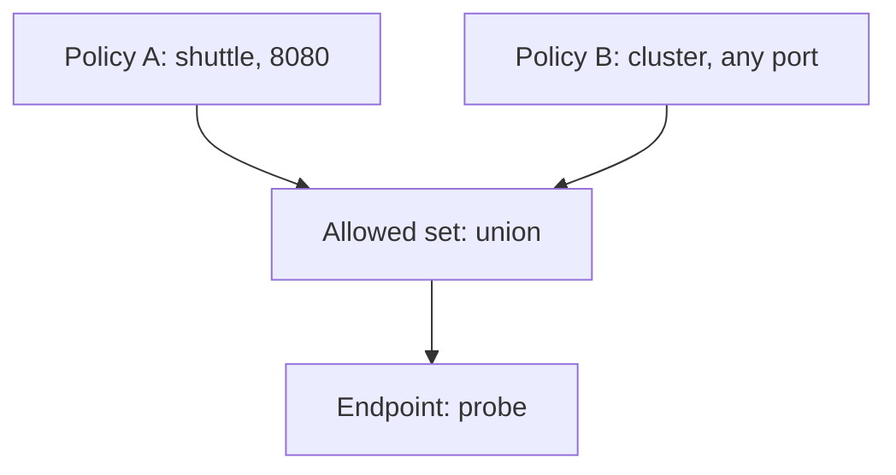

# Peers, Ports And How Rules Combine

A policy that names a subject and a direction is only half of a contract. The other half says who may talk to the subject and over which protocol and port. Reading this half correctly is the core skill of the exam objective, because most real policies contain several rules, and each rule has several fields.

This part explains what one rule means, and then what several rules mean together. The two levels use different logic, and mixing them up is the most common reading mistake.

## Fields inside one rule are joined with AND

A rule is one list item under `ingress` or `egress`. It can contain a peer field and a `toPorts` field. A request must match both to be allowed.

```yaml
ingress:
- fromEndpoints:
  - matchLabels:
      app: shuttle
  toPorts:
  - ports:
    - port: "8080"
      protocol: TCP
```

This rule allows a connection only if the source endpoint has the label `app: shuttle` and the destination port is TCP 8080. A `shuttle` pod that connects to port 9090 does not match. A pod without the label `app: shuttle` that connects to port 8080 does not match either.

The peer fields of ingress rules are `fromEndpoints`, `fromEntities`, `fromCIDR` and `fromCIDRSet`. The matching egress fields are `toEndpoints`, `toEntities`, `toCIDR`, `toCIDRSet` and `toFQDNs`. A rule with no peer field applies to all peers, so a rule that has only `toPorts` allows those ports from anyone.

## Peers inside one field are joined with OR

A peer field is a list. Each list item is one selector. A source that matches any one item is a match.

```yaml
ingress:
- fromEndpoints:
  - matchLabels:
      app: shuttle
  - matchLabels:
      app: scout
```

This rule allows endpoints labelled `app: shuttle` and endpoints labelled `app: scout`. Inside one item, several labels are joined with AND. An item with `app: shuttle` and `team: bridge` matches only endpoints that carry both labels.

## Several rules add up

A policy can have many rules, and a namespace can have many policies. Cilium builds the allowed set from the union of all allow rules that select an endpoint. A new allow rule can only add permitted traffic. It cannot remove traffic that another rule already permits.

This is the reason a narrow policy can lose its effect. If one policy allows `shuttle` to reach `probe` on port 8080, and another policy allows every endpoint in the cluster to reach `probe` on every port, the effective set is the broad one. To read the real contract of an endpoint, list every policy that selects it and take the union.



The drawing shows two allow policies feeding one allowed set for the `probe` endpoint. The agent enforces the union, not the more restrictive policy.

## The three kinds of peer

An endpoint selector matches pods by their labels, which Cilium turns into a security identity. An entity matches a built-in group such as `world`, `host` or `cluster`. A CIDR (Classless Inter-Domain Routing) block matches an IP address range, which is meant for destinations outside the cluster.

A rule should use the kind of peer that fits the destination. In-cluster pods should be selected by labels. Addresses outside the cluster should use CIDR or fully qualified domain names. Using a CIDR for a pod works poorly, because pod addresses change when a pod restarts.

## Layer 7 rules narrow a port further

A `toPorts` entry can carry a `rules` field with HTTP rules, for example a method and a path. This is a Layer 7 (application layer) rule. It also joins with AND: the port must match and the HTTP request must match. A request to an allowed port with a forbidden path is rejected by the proxy, and the client receives an HTTP 403 response instead of a timeout.

Cilium sends the traffic of a Layer 7 rule through Envoy, a proxy that runs on each node. This is why Layer 7 rules depend on the agent and the proxy being healthy, while Layer 3 and Layer 4 rules run in the kernel.

## A worked reading

Take this policy for the `probe` endpoint. It has two ingress rules.

```yaml
ingress:
- fromEndpoints:
  - matchLabels:
      app: shuttle
  toPorts:
  - ports:
    - port: "8080"
      protocol: TCP
- fromEntities:
  - host
```

The first rule allows `shuttle` on TCP 8080. The second rule has no `toPorts`, so it allows the entity `host` on every port and protocol. The entity `host` is the node that runs the pod, including processes in host networking mode.

The effective contract has two statements. First, `shuttle` may open TCP connections to port 8080. Second, the local node may connect on any port. Everything else, such as `shuttle` on port 9090 or a pod in another namespace on port 8080, is dropped. If you only read the first rule, you miss the second statement, and you miss that a node-level process can reach every port of the pod.

## Reading the effective contract

Use this order when you read a policy. First, find the kind and namespace. Second, read the `endpointSelector` to know the subject. Third, for each direction that has a section, list the rules. Fourth, in each rule, combine the peer and the port with AND. Fifth, join the rules with OR. Last, add the rules of every other policy that selects the same endpoint.

The answer is a list of statements of the form "endpoints with these labels may connect to these endpoints on this port". Anything not on the list is dropped, for each direction that a policy selects.

You now can read the allowed set of one endpoint. What remains is to prove it with real requests, and to see how Cilium reports a request that the policy blocks.

## Common pitfalls

> [!WARNING]
> Fields in one rule are joined with AND, list items are joined with OR, and separate policies are joined by union. A rule that lists only `toPorts` allows those ports from every peer. A peer selector without the namespace label matches only the namespace of the policy.
