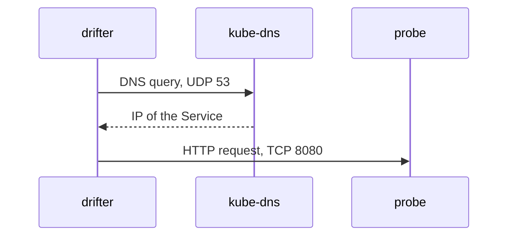

# Egress Dependencies And DNS

An application rarely talks to one fixed address. It talks to names, and a name has to be turned into an IP address before the first packet is sent. When you restrict egress, you cut off the DNS (Domain Name System) lookup together with everything else, unless the policy allows it. This part shows why a correct-looking egress policy fails, and how to write a complete one.

## A policy that looks correct and fails

The `drifter` pod in `outpost` calls the `probe` Service by name. A first attempt at an egress policy allows only the `probe` pods on port 8080.

```yaml
apiVersion: cilium.io/v2
kind: CiliumNetworkPolicy
metadata:
  name: drifter-egress-incomplete
  namespace: outpost
spec:
  endpointSelector:
    matchLabels:
      app: drifter
  egress:
  - toEndpoints:
    - matchLabels:
        k8s:io.kubernetes.pod.namespace: starfleet
        app: probe
    toPorts:
    - ports:
      - port: "8080"
        protocol: TCP
```

The rule allows the destination. It does not allow the lookup of the name `probe.starfleet.svc`. The `drifter` pod sends that lookup to the cluster DNS service on UDP port 53, and the policy drops it because the policy puts `drifter` into default deny for egress. The application reports a name resolution error, and the cause is in a different rule than the one you were looking at.

## What happens during a request

Three steps happen before the HTTP request reaches `probe`. Each step is a separate connection, and each one needs its own egress permission.



The diagram shows that `drifter` first talks to `kube-dns` and only then to `probe`. An egress policy that lists only the second connection breaks the first one.

The cluster DNS service in a standard cluster is CoreDNS. Its pods run in `kube-system` and carry the label `k8s-app: kube-dns`. A policy selects them with the namespace label and that label.

## The complete egress policy

The next policy has two egress rules. The first rule allows DNS to the `kube-dns` pods. It also carries a DNS rule, `matchPattern: "*"`, which makes Cilium send the DNS traffic through its DNS proxy, a component in the agent that sees each query. The second rule allows the `probe` pods on TCP port 8080.

Renew the playground and connect before the first step.

<!-- astrona:playground:renew -->

```sh
export KUBECONFIG="$(astrona kubeconfig ats-053-playground-010-02)"
kubectl config current-context
```

Save this as `ciliumnetworkpolicy-drifter-egress.yaml`:

```yaml
apiVersion: cilium.io/v2
kind: CiliumNetworkPolicy
metadata:
  name: drifter-egress
  namespace: outpost
spec:
  endpointSelector:
    matchLabels:
      app: drifter
  egress:
  - toEndpoints:
    - matchLabels:
        k8s:io.kubernetes.pod.namespace: kube-system
        k8s:k8s-app: kube-dns
    toPorts:
    - ports:
      - port: "53"
        protocol: ANY
      rules:
        dns:
        - matchPattern: "*"
  - toEndpoints:
    - matchLabels:
        k8s:io.kubernetes.pod.namespace: starfleet
        app: probe
    toPorts:
    - ports:
      - port: "8080"
        protocol: TCP
```

Apply it:

```sh
kubectl apply -f ciliumnetworkpolicy-drifter-egress.yaml
```

Then check the result. The first request uses a name and needs DNS. The second request goes to the Kubernetes API Service on port 443, which no rule allows.

```sh
kubectl -n outpost exec drifter -- python -c "import urllib.request; print(urllib.request.urlopen('http://probe.starfleet.svc:8080/',timeout=4).read().decode())"
kubectl -n outpost exec drifter -- python -c "import urllib.request; urllib.request.urlopen('http://kubernetes.default.svc:443/',timeout=3).read()"
```

The first request prints `probe-ready`. The second request ends with an error that contains `timed out`. The name `kubernetes.default.svc` resolves, because DNS is allowed, but the connection to the API Service is dropped.

## The DNS rule is more than a port

Allowing UDP port 53 alone is enough for name resolution. The `rules.dns` block adds the DNS proxy, which has two effects. It lets you filter by the queried name, and it feeds the `toFQDNs` rules described next. `matchPattern: "*"` allows every name, so the policy still allows any query but makes the proxy see all of them.

## toFQDNs: policy by name

A `toFQDNs` rule allows egress to the IP addresses that the DNS proxy has seen for a name. It is meant for destinations outside the cluster, such as an external API. It has two selectors: `matchName` for one exact name, and `matchPattern` for a name with the wildcard `*`.

```yaml
egress:
- toFQDNs:
  - matchName: "api.example.com"
```

A `toFQDNs` rule does nothing on its own. The same endpoint also needs a DNS rule as shown above, because Cilium learns the addresses from the DNS answers that pass through the DNS proxy. A `toFQDNs` rule also cannot be combined with `toEndpoints` or `toCIDR` in the same rule. A name that was never resolved by the pod through the proxy has no addresses, so the connection is dropped.

## What this part showed

A complete egress policy lists every dependency of the application: the DNS service first, then each destination. A `toFQDNs` rule depends on the DNS rule beside it. The next question is how to prove what the agent actually enforces when the application still fails.

## Common pitfalls

> [!WARNING]
> Restricting egress without allowing the DNS service breaks every name lookup. A `toFQDNs` rule needs a DNS rule for the same endpoint, and it cannot share a rule with `toEndpoints` or `toCIDR`. Pods can use a different DNS service than `kube-dns`, so check the labels of the real DNS pods.
