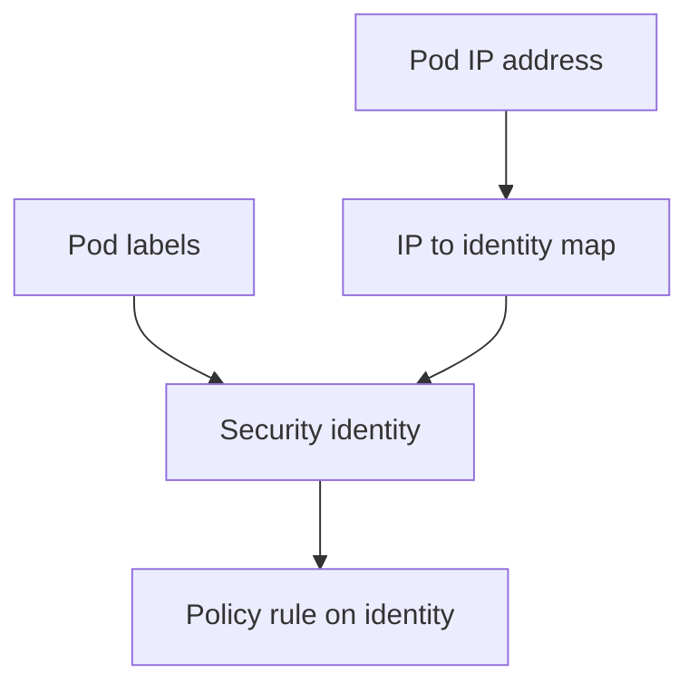

# Why Identity Replaces The IP Address

Pods in a cluster start, stop and move all the time, and each new pod gets a new IP address. A security model that stores IP addresses must change its rules at every one of those events. This part explains the problem with address-based rules and how Cilium solves it with identities.

## The problem with address-based rules

Suppose all pods with the label `role=frontend` may connect to all pods with the label `role=backend`. A firewall that works with IP addresses needs a rule such as "allow source 10.1.2.2, 10.1.2.3 and 20.4.9.1 to reach destination 10.1.1.2". Every time a `frontend` pod starts or stops, its address must be added to or removed from the rule list on every node that runs a `backend` pod.

In a large cluster with many pod restarts, this means many rule updates per second on many nodes. A new `frontend` pod also cannot send its first request until all those nodes have been updated. Otherwise the first connections are dropped by mistake. The work grows with the number of pods and the rate of change.

## The identity solution

Cilium separates security from network addressing. It derives a security identity from the labels of the pod, and the identity is shared by all pods with the same relevant labels. A rule says "identity of `role=frontend` may connect to identity of `role=backend`". The rule contains no IP address.

When another `frontend` pod starts, Cilium looks up the identity for its label set. The identity already exists, so the pod joins it. No rule changes on the nodes that run `backend` pods. The only work is to resolve the identity and to remember which IP address belongs to it.

The drawing shows that labels produce the identity, the policy rule uses the identity, and a separate map connects each IP address to its identity.

## Who does what

Three components have a role. The Cilium agent on each node watches pods and creates an endpoint for each local pod. The Cilium operator and agents allocate identities and, in the default mode, store each identity as a `CiliumIdentity` custom resource in the Kubernetes API. The kernel datapath, which is the eBPF program loaded by the agent, applies the rules on each packet.

eBPF (extended Berkeley Packet Filter) is a Linux kernel feature that runs small verified programs at network hooks. The agent loads these programs, and they look up the identity of the source and the destination of each packet to decide whether the policy allows it.

## Where the identity comes from on a packet

When a packet arrives, the datapath must know the identity of the sender. On the same node, the datapath knows the local endpoint that sent it. For traffic that arrives from another node through a tunnel, the identity travels in the tunnel header. In other routing modes, the datapath uses the source IP address and an IP-to-identity map that the agent keeps in the kernel.

This is the point where addresses still matter. Identity decides what the policy allows, but the IP-to-identity map must be correct for the decision to be correct. When a pod is replaced, the agent updates the map for its new address.

## What the identity does not do

A Cilium security identity is a network-layer identity. It is not a Kubernetes service account, and it is not an application login. Kubernetes RBAC (role-based access control) decides who may call the Kubernetes API. The application decides who may use its own functions. Cilium decides which endpoints may exchange packets.

A request can be allowed by the network policy and still be refused by the application. A request can also pass application checks and be dropped by the network policy. Each layer needs its own configuration.

## Reading a policy through identities

Take the rule `fromEndpoints: [{matchLabels: {app: shuttle}}]` as an example. The agent translates the selector into the set of identities whose labels include `app: shuttle`. It then writes the allowed identities into a policy map for the destination endpoint. At runtime, the kernel compares the identity of the packet source with that map.

This also explains a behaviour that surprises many readers. If you change a label on a running pod, the pod gets a different identity. A policy that matched the old labels no longer matches it, and a policy that matches the new labels starts to match, without any change to the policy.

## A worked comparison with numbers

Take a cluster with 200 `frontend` pods and 50 `backend` pods on 20 nodes. An address-based rule on each node that runs a `backend` pod lists up to 200 source addresses. If 10 percent of the `frontend` pods restart in one minute, 20 addresses change in that minute, and each change must reach every node that runs a `backend` pod before the new pod can connect.

With identities, the same cluster has one identity for the `frontend` labels and one for the `backend` labels. The rule on each `backend` node holds one allowed identity. The 20 restarts change only the IP-to-identity map on the nodes, and the rule itself never changes. The map update is also cheaper, because it is a single key and value, not a rewrite of a rule list.

## Where each lookup happens

There are two lookups, and they have different jobs. The first lookup finds the identity of the packet source. The second lookup asks whether the destination endpoint allows that identity on that port and protocol. The second lookup uses a per-endpoint policy map in the kernel, and its keys are an identity, a port and a protocol. A packet that finds no matching key is dropped when the endpoint has policy enforcement for that direction.

This split explains why a policy change takes effect in the kernel without a restart of the pod. The agent only updates the policy map of the affected endpoints.

## What stays address based

Not everything has a Cilium identity. A destination outside the cluster has no labels, so Cilium cannot build an identity from labels. For such destinations Cilium uses reserved identities and CIDR ranges, and it allocates a local identity for each CIDR range that a policy names. Address-based rules are still the correct tool for traffic to external systems.

## Failure cases to expect

If the agent on a node is down or restarting, the policy maps already loaded in the kernel keep working, so existing rules still apply. New pods on that node cannot receive an identity until the agent returns, and the datapath cannot learn new address mappings. The result is that connections from a brand-new pod may be dropped until its identity is known.

If two different label sets are meant to be the same group but differ in one relevant label, they get two identities. A policy that selects only one of them blocks the other group. The cause is the label, not the network, and the identity list shows it at once.

## Identity across clusters

An identity number is allocated inside one cluster. Two clusters can use the same number for different label sets. For this reason, a number never travels as a durable name. The label set is the meaning, and the number is only a short key for it in one cluster.

When clusters are connected, the clusters must share an identity space, and Cilium uses a cluster label so that the same labels from two clusters stay distinct when they need to be.

## What this part showed

Cilium replaces address lists with identities derived from labels, which keeps rules stable while pods come and go. The identity is a network-layer concept that the datapath compares on every packet. The next part looks at how the labels are chosen and which labels never count.

## Common pitfalls

> [!WARNING]
> A security identity is not a Kubernetes service account or an application credential. A label change on a pod changes its identity. Address independence still needs a correct IP-to-identity map on each node.
