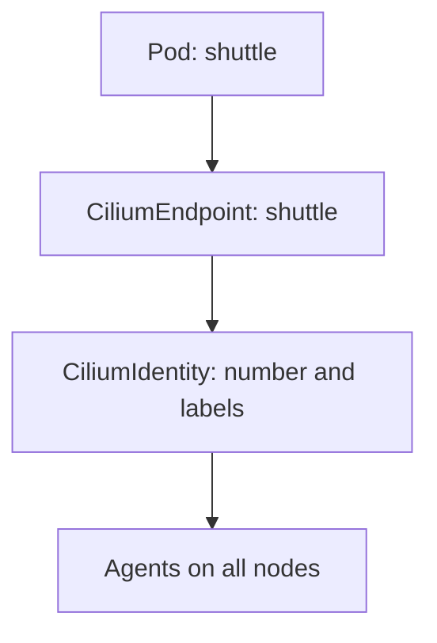

# How Labels Become An Identity

Two pods with the same labels share one identity, and two pods with different labels do not. That rule sounds simple, but Kubernetes adds many labels that you did not write. If Cilium used all of them, pods from the same Deployment would get different identities. This part explains which labels Cilium uses and how the result is stored.

## Identity-relevant labels

The labels that Cilium uses to build an identity are called identity-relevant labels. Cilium takes the pod labels and the namespace of the pod, and it removes labels that are noise. The default filter ignores labels such as `pod-template-hash` and `controller-revision-hash`, which Kubernetes adds to every pod of a rollout, and labels in the `k8s.io` and `kubernetes.io` areas.

The filter matters because replicas of one Deployment must share one identity. Pods from different ReplicaSets of the same application carry different `pod-template-hash` values. Without the filter, every rollout would create a new identity and every policy would need to be recomputed.

Cilium adds labels as well. It adds the namespace as `k8s:io.kubernetes.pod.namespace`, and it adds the service account of the pod as a label. A pod in another namespace therefore has a different identity even if its own labels are the same. The `k8s:` prefix names the source of the label, which here is Kubernetes. Cilium also knows other sources, such as `reserved:`.

## One label set, one identity number

An identity is a number. Identities for pods are allocated starting at 256. The numbers below 256 are reserved for special cases. Two pods with the same relevant label set get the same number, even on different nodes.

Cilium stores the label set and the number together in a `CiliumIdentity` resource. The identity of a pod is also visible in its `CiliumEndpoint` resource, which the agent creates for each endpoint. These are two views of the same facts, one by identity and one by endpoint.

The drawing shows that each pod has a CiliumEndpoint, the endpoint points to a CiliumIdentity, and the agents on all nodes read the identity.

## Selectors become identity sets

A selector in a policy is evaluated against these label sets. `matchLabels: {app: shuttle}` selects every identity whose label set contains `app: shuttle`. An identity with extra labels still matches, because the selector asks for a subset. This is why a rule written with one label keeps working when you add a second label to the pods.

A selector with several labels needs all of them. `matchLabels: {app: shuttle, team: bridge}` selects only identities that carry both labels. Adding a label to a pod can make it match a new rule. Removing a label can make it stop matching an existing rule.

## Why the namespace label matters

Because the namespace is part of the identity, a peer selector in a namespaced policy defaults to the namespace of the policy. A rule in `starfleet` that says `fromEndpoints: [{matchLabels: {app: drifter}}]` selects `app: drifter` pods in `starfleet` only. The `drifter` pod in `outpost` does not match, even though its label is the same.

To select pods in another namespace, the rule must contain the namespace label. A CiliumClusterwideNetworkPolicy has no namespace, so an unqualified selector there matches pods in every namespace.

## Who may set the labels

Because labels decide the identity, whoever can create or label a pod can choose the identity of that pod. A user who can add `team: bridge` to any pod can place that pod in the identity that a policy trusts. The network policy then correctly enforces a rule on a label that was set by the wrong person.

Control over labels therefore belongs to the security design. Kubernetes RBAC rules can limit who may create or patch pods. An admission policy can limit which label values a namespace may use. Cilium cannot see who set a label, it only sees the label.

## Changing the identity-relevant labels

An administrator can change which labels count by setting the agent option `labels` in the Cilium configuration. Doing so changes how existing identities are computed, so it is a cluster-wide change that needs planning. For this course, the default filter is the model to learn.

## A worked example with two pods

Take two pods in `starfleet`. The pod `shuttle` has the labels `app=shuttle` and `pod-template-hash=7d9`. The pod `scout` has the label `app=scout`.

The relevant labels of `shuttle` are `k8s:app=shuttle` and the namespace label. The label `pod-template-hash` is dropped by the filter. The relevant labels of `scout` are `k8s:app=scout` and the namespace label. The two label sets differ, so the pods have two identities.

Now start a second `shuttle` pod from a new ReplicaSet, with `pod-template-hash=a41`. After the filter its relevant labels are the same as before, so the new pod joins the identity of the first `shuttle` pod. A policy that allows the identity of `app=shuttle` therefore covers both pods without any change.

## Where the label sources come from

Each label in an identity has a source prefix. The prefix `k8s:` marks a label that came from Kubernetes. The prefix `reserved:` marks a label that Cilium assigned to a built-in identity. Other prefixes exist for labels from other sources, such as container runtimes or other clusters. A selector without a prefix defaults to the `k8s:` source, so a selector `app: shuttle` means `k8s:app=shuttle`.

A selector can also name the prefix explicitly, which is how the namespace label is written in a rule: `k8s:io.kubernetes.pod.namespace`. The prefix avoids a clash between labels from different sources that have the same key.

## Failure cases to expect

A common failure is a selector that names a label the pods do not carry. The selector then matches no identity, and a policy that allows nothing puts the subject into default deny for that direction. The pods look healthy, and the requests time out.

Another failure is a typo in the namespace label key. The key is `k8s:io.kubernetes.pod.namespace`. A key written with a different spelling matches no identity, so the rule allows no traffic. When a rule does not work, compare the selector labels with the identity labels character by character.

## Identity storage modes

By default, the agents store identities as `CiliumIdentity` resources in the Kubernetes API and allocate the numbers through it. Large clusters can instead keep the identities in a separate key-value store. In both modes the result for a policy is the same: a label set maps to one number that every node agrees on.

The practical effect is that every agent in the cluster resolves the same labels to the same identity number, which is the property that policy enforcement on every node depends on.

## Reading the result in one command

The agent can print the labels of one identity number. Use `cilium-dbg identity get <NUMBER>` on an agent pod to see the label set behind a number. The output lists each label with its source prefix, so you can compare it with your selector.

## What this part showed

An identity is a number for a set of relevant labels plus the namespace. Selectors match subsets of the label set. Whoever can change labels can change identities. The next part reads real identities from the playground and shows what happens when a label changes.

## Common pitfalls

> [!WARNING]
> A selector without the namespace label matches only the namespace of a namespaced policy. A selector matches a subset of an identity label set, so extra labels never break a match. Anyone who can set pod labels can pick the identity of a pod.
