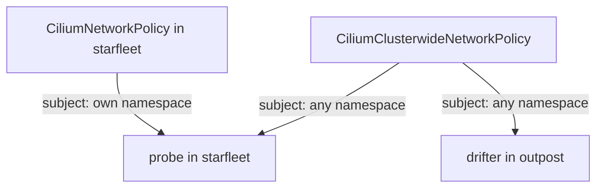

# Selecting Peers Across Namespaces

A real cluster has many namespaces, and the clients of one service often live in a different namespace than the service. A selector that ignores this gives wrong results in two directions: it blocks a client you meant to allow, or it allows a client you meant to block. This part shows how the namespace becomes part of the selection, and how the two Cilium policy kinds differ in scope.

## The namespace is part of the identity

Cilium adds the namespace of a pod to its identity as the label `k8s:io.kubernetes.pod.namespace`. Two pods with the same `app` label in two namespaces therefore have two identities. A selector has to say which namespace it means, or it uses the default of the policy.

In a CiliumNetworkPolicy, the default namespace for every peer selector is the namespace of the policy. A rule in `starfleet` that allows `app: drifter` selects only the `drifter` pods in `starfleet`. The `drifter` pod in `outpost` does not match.

## Selecting a peer in another namespace

To select a pod in another namespace, add the namespace label to the selector. The next policy lives in `starfleet`, selects the `probe` pods, and allows ingress on TCP port 8080 from the pods with `app: drifter` in `outpost`.

Renew the playground and connect before the first step.

<!-- astrona:playground:renew -->

```sh
export KUBECONFIG="$(astrona kubeconfig ats-053-playground-020-02)"
kubectl config current-context
```

The context must be `kind-astro-ats-053-playground-020-02`.

Save this as `ciliumnetworkpolicy-allow-drifter.yaml`:

```yaml
apiVersion: cilium.io/v2
kind: CiliumNetworkPolicy
metadata:
  name: allow-drifter
  namespace: starfleet
spec:
  endpointSelector:
    matchLabels:
      app: probe
  ingress:
  - fromEndpoints:
    - matchLabels:
        app: drifter
        k8s:io.kubernetes.pod.namespace: outpost
    toPorts:
    - ports:
      - port: "8080"
        protocol: TCP
```

Apply it:

```sh
kubectl apply -f ciliumnetworkpolicy-allow-drifter.yaml
```

Then check the result. The request from `drifter` must print `probe-ready`. The request from `shuttle` must time out, because the policy puts `probe` into default deny for ingress and allows only `drifter`.

```sh
kubectl -n outpost exec drifter -- python -c "import urllib.request; print(urllib.request.urlopen('http://probe.starfleet.svc:8080/',timeout=4).read().decode())"
kubectl -n starfleet exec shuttle -- python -c "import urllib.request; urllib.request.urlopen('http://probe.starfleet.svc:8080/',timeout=3).read()"
```

The second command ends with an error that contains `timed out`.

## Two policy kinds, two scopes

A CiliumNetworkPolicy is a namespaced resource. Its subject, set by `endpointSelector`, can only be a pod in the namespace of the policy. A CiliumClusterwideNetworkPolicy (CCNP) has the same fields, but it has no namespace. Its `endpointSelector` can select pods in every namespace.

The clusterwide kind is the right tool for a rule that belongs to the whole cluster, such as a baseline that every namespace needs. The namespaced kind is the right tool for a rule that one team owns, because Kubernetes RBAC (role-based access control) can then limit who may edit it.



The drawing shows that a clusterwide policy can select subjects in every namespace, while a namespaced policy selects only subjects in its own namespace.

## Selectors in a clusterwide policy

In a CCNP, a selector without a namespace label matches pods in every namespace. The rule `fromEndpoints: [{matchLabels: {team: bridge}}]` in a CCNP allows every pod with `team=bridge`, in any namespace. The same rule in a namespaced policy allows only pods of the policy namespace.

To restrict a clusterwide rule to one namespace, add the namespace label to the selector. Only a clusterwide policy can use `nodeSelector` to select nodes instead of pods.

## What this part showed

The namespace is part of the identity, so a peer selector needs the namespace label to cross a namespace boundary. A namespaced policy defaults to its own namespace, and a clusterwide policy matches every namespace. The next part moves from pods to peers that have no pod labels.

## Common pitfalls

> [!WARNING]
> A selector without the namespace label cannot reach another namespace from a namespaced policy. The same selector in a clusterwide policy matches every namespace, which is wider than most authors intend. A namespaced policy can never select a subject outside its own namespace.
