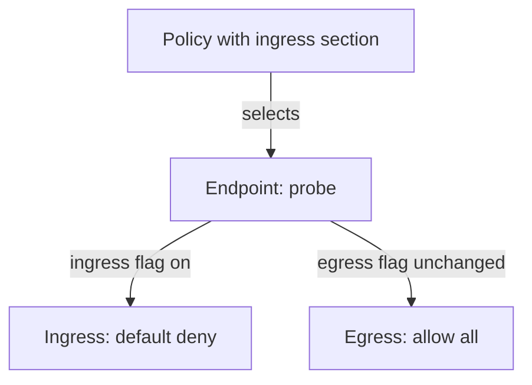

# The Three Enforcement Modes

Before any policy exists, a cluster that runs Cilium forwards all pod traffic. Once the first policy exists, some traffic is dropped. The question is when exactly the switch happens, and for which endpoints. Cilium answers this with the policy enforcement mode, and this part explains the three values and the rule behind the default.

## Enforcement is per endpoint and per direction

Cilium tracks two flags for each endpoint: one for ingress and one for egress. When a flag is off, the endpoint allows all traffic in that direction. When a flag is on, the endpoint is in default deny for that direction, and it allows only the traffic that some rule allows. The agent evaluates the flags on its own node for each local endpoint.

The mode decides how the flags are set. The mode is a setting of the agent, named `enable-policy` in the agent configuration and `policyEnforcementMode` in the Helm chart. It has three values: `default`, `always` and `never`.

## The default mode

In `default` mode, an endpoint starts with both flags off. A policy turns a flag on only when the policy selects the endpoint as its subject and has a rule section for that direction.

A policy that has an `ingress` section turns on ingress enforcement for its subject. It leaves the egress flag as it was. A policy with only an `egress` section does the reverse. This is the rule behind many surprises: a policy that restricts ingress does not restrict what the same pod sends out.

The drawing shows that a policy with an ingress section turns on ingress enforcement only, and the egress direction keeps allowing all traffic.

An empty section also counts. A rule list such as `ingress: [{}]` selects the endpoint for ingress and contains one rule that allows all, so the flag is on and the traffic is still allowed. The result of a section depends on its rules, but the flag depends on the section being present.

## The always mode

In `always` mode, every endpoint has both flags on from the start, whether or not a policy selects it. An endpoint with no policy allows nothing in either direction. The cluster is closed by default, and every flow needs an explicit allow rule.

This mode fits environments where an unprotected pod is a defect. The price is that cluster services need rules too. Name lookups to the DNS service, traffic from the kubelet and calls to the Kubernetes API server all need rules, or they are dropped.

## The never mode

In `never` mode, no endpoint has an enforcement flag on, and policy is not applied. Policies can exist as objects, but they do not change traffic. This mode is a diagnostic tool and a way to run Cilium only for networking. It is not a safe state for a shared cluster.

A policy exists in the Kubernetes API in all three modes. The mode decides whether the agent enforces it. An administrator who sees a policy that has no effect should check the mode before the selectors.

## An example in default mode

Take the `probe` pods in `starfleet`. No policy selects them, so both flags are off, and `shuttle` and `drifter` can both reach `probe`. Now add a policy that selects `app: probe` and allows ingress on TCP port 8080 from `app: shuttle`.

The ingress flag of `probe` turns on. `shuttle` still reaches `probe`, and `drifter` is dropped, because no rule allows it. The egress flag of `probe` stays off, so `probe` can still open connections to any destination. The agent shows both facts in the endpoint list.

## Why default mode is the usual choice

The `default` mode lets a team adopt policy one workload at a time. A cluster can run for months with a few protected workloads while the rest stay open. The mode `always` removes that gradual path, because the first day already needs rules for every pod.

The trade-off is visibility. In `default` mode, a pod that no policy selects is open, and nothing warns you. A review of the enforcement flags shows which endpoints are open.

## How the flags combine across policies

Several policies can select one endpoint. The ingress flag is on if at least one of them has an ingress section. The egress flag is on if at least one has an egress section. The allowed set for each direction is the union of the rules of all selecting policies for that direction.

A second policy that selects the endpoint only for egress turns on the egress flag, and it does not change the ingress rules. Deleting the last policy with an ingress section turns the ingress flag off, and the endpoint becomes open for ingress again. This is a risk in practice: a cleanup that removes a policy can open an endpoint without any warning.

## Ingress and egress are separate decisions

A connection between two endpoints passes two checks. The egress check at the source endpoint asks whether the source may send the flow. The ingress check at the destination endpoint asks whether the destination may receive it. Each check uses the flag and rules of its own endpoint.

If the source has no egress enforcement and the destination has no ingress enforcement, the connection is allowed. If only the destination enforces ingress, only the destination rules decide. If both enforce, both must allow, and the flow needs one rule on each side.

## The reply traffic

Policy decides who may start a connection. Cilium tracks connections, so the reply packets of an allowed connection are allowed automatically. A rule for the reply direction is not needed and does not exist in the API. A common mistake is to add an egress rule on the server for the answers to a request.

## Reading a case from the exam point of view

A typical question gives one policy and asks what happens to a request. Work through it in a fixed order. First, find the subject of the policy and decide which endpoints it selects. Second, find the directions that the policy has sections for. Third, check the mode, because `always` and `never` override the per-policy rule. Fourth, apply the allowed set to the request.

For a request to a pod that the policy does not select, the answer in `default` mode is always that the request is allowed on that side. For a request from a pod that is selected only for ingress, the answer for egress is also allowed.

## Where the flags live

The flags are state of the agent, not fields of the policy objects. The agent recomputes them when a policy, an identity or a label changes. For this reason the enforcement state can change without any edit to a policy: a label change on a pod can make a policy select it, or stop selecting it.

## What this part showed

Each endpoint has an ingress flag and an egress flag. In `default` mode a policy turns on a flag for its subject in the direction of its sections. In `always` mode both flags are on everywhere, and in `never` mode they are off everywhere. The next part shows how to read the mode and what `always` does to cluster services.

## Common pitfalls

> [!WARNING]
> A policy with only an ingress section leaves egress open for its subject. A policy object that exists but has no effect may be a result of the `never` mode. An endpoint that no policy selects is open in `default` mode, even if neighbours are protected.
