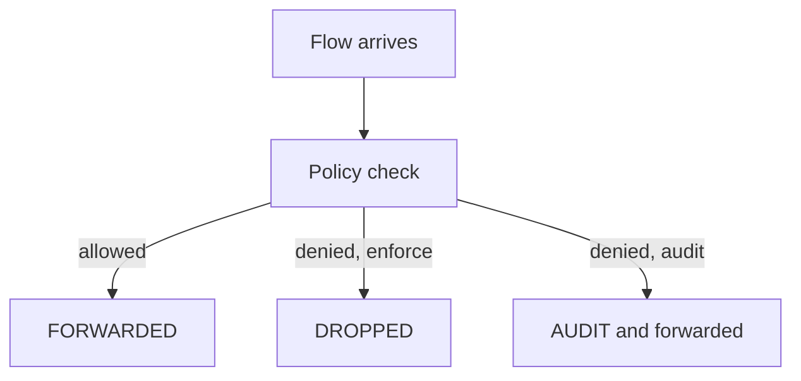

# Audit Mode

A policy that is correct on paper can still drop a flow that the application needs: a health check, a metrics scrape or a call to a rarely used dependency. The usual way to find these flows is an outage. Audit mode finds them earlier. This part explains what audit mode does, how to switch it on, and how to read what it reports.

## What audit mode does

In audit mode, the agent evaluates policy as usual. When a flow would be dropped by policy, the agent allows it instead, and it reports the flow as an audit event. The flow reaches its destination, and an observer sees that a rule is missing.

Audit mode changes only the verdict of policy drops. It does not change identity handling, and it does not disable policy. A flow that a policy allows is reported as allowed, and a flow that no policy would allow is reported as an audit.

## Two ways to enable it

Audit mode can apply to the whole agent or to a single endpoint. The agent flag `--policy-audit-mode` turns it on for every endpoint of the agent. The Helm value for it is `policyAuditMode`, and a change needs an agent restart like other agent settings.

The per-endpoint option is named `PolicyAuditMode`. It is set with the endpoint configuration command of the agent, `cilium-dbg endpoint config <ENDPOINT_ID> PolicyAuditMode=Enabled`. This is the option for a staged rollout, because only the chosen endpoint is in audit mode while others stay in enforcement.

## The verdicts that Hubble shows

Hubble is the observability layer of Cilium. It records each flow with a verdict. `FORWARDED` means the flow was allowed. `DROPPED` means the flow was dropped, for example by policy. `AUDIT` means a policy would have dropped the flow, and audit mode allowed it.



The drawing shows that a denied flow is dropped in enforcement and forwarded with an `AUDIT` verdict in audit mode.

## Use audit mode on one endpoint

Renew the playground and connect. First, apply a policy that allows only `shuttle` to reach `probe`. Then, before any test, put the `probe` endpoint into audit mode and observe that `drifter` still reaches it.

<!-- astrona:playground:renew -->

```sh
export KUBECONFIG="$(astrona kubeconfig ats-053-playground-030-02)"
kubectl config current-context
```

Save this as `ciliumnetworkpolicy-allow-shuttle.yaml`:

```yaml
apiVersion: cilium.io/v2
kind: CiliumNetworkPolicy
metadata:
  name: allow-shuttle
  namespace: starfleet
spec:
  endpointSelector:
    matchLabels:
      app: probe
  ingress:
  - fromEndpoints:
    - matchLabels:
        app: shuttle
    toPorts:
    - ports:
      - port: "8080"
        protocol: TCP
```

Apply it:

```sh
kubectl apply -f ciliumnetworkpolicy-allow-shuttle.yaml
```

Then find the endpoint number of the `probe` pod in the agent list, on the agent of the node that hosts the pod. Replace `<AGENT_POD>` with the agent pod name and `<ENDPOINT_ID>` with that number.

```sh
kubectl -n kube-system exec <AGENT_POD> -- cilium-dbg endpoint list
kubectl -n kube-system exec <AGENT_POD> -- cilium-dbg endpoint config <ENDPOINT_ID> PolicyAuditMode=Enabled
```

Now send the request from `drifter` again. Without audit mode it times out. With audit mode it prints `probe-ready`.

```sh
kubectl -n outpost exec drifter -- python -c "import urllib.request; print(urllib.request.urlopen('http://probe.starfleet.svc:8080/',timeout=4).read().decode())"
```

The agent monitor shows the audited flow. The command streams events of the policy verdict type and stops with Control and C.

```sh
kubectl -n kube-system exec <AGENT_POD> -- cilium-dbg monitor --type policy-verdict
```

Look for the line of the request from `drifter` and its verdict text, which says that the flow was audited. The exact text and the numbers are not printed here, because they differ between versions and clusters.

To leave audit mode, set the option back to `Disabled` with the same command. The next request from `drifter` times out again.

## Reading audit results as a work list

Every audited flow names a source identity, a destination identity, a port and a direction. Each one is a flow that the policy lacks a rule for. For each flow, the team decides one of two things. The flow is wanted, so a rule is added. Or the flow is unwanted, so the drop in enforcement is the intended result.

A good audit period covers the full cycle of the application, including jobs that run once a day or once a week. A flow that happens monthly does not show up in an hour of audit.

## What audit mode does not cover

Audit mode reports the verdict of policy. It does not report problems that are not policy, such as a missing Service endpoint. Layer 7 rules can also behave differently, because the proxy sees the traffic. Treat audit results of Layer 7 rules with care and test them before enforcement.

## What this part showed

Audit mode lets a policy report its drops without dropping. It applies to the whole agent through a flag or to one endpoint through the `PolicyAuditMode` option, and the verdict `AUDIT` marks the flows. The next part covers the second tool, a rule that adds allows without enforcing default deny.

## Common pitfalls

> [!WARNING]
> Audit mode allows flows that the policy would drop, so the endpoint is not protected while the mode is on. The per-endpoint option is lost when the endpoint is recreated, for example when a pod restarts. A short audit window misses flows that happen rarely.
