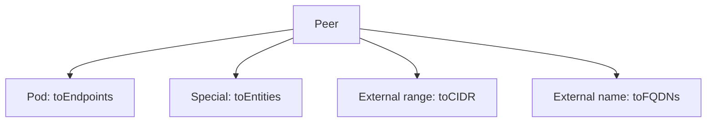

# Policy Anatomy And Peer Selectors

A policy has to answer four questions: which endpoints does it protect, in which direction, who is the peer, and which traffic is allowed. Cilium puts each answer in its own field. This part walks through the fields from the top and then looks at the three ways to name a peer.

## The top-level fields

A CiliumNetworkPolicy has `apiVersion: cilium.io/v2`, `kind: CiliumNetworkPolicy`, `metadata` and either `spec` or `specs`. The `spec` field holds one rule. The `specs` field holds a list of rules, for authors who want several rules in one object. Each rule has the same fields.

The field `endpointSelector` selects the subject, which is the set of endpoints that the rule protects. An empty selector `{}` selects every endpoint in the namespace of the policy. The field `nodeSelector` selects nodes instead of pods, and it is valid only in a CiliumClusterwideNetworkPolicy.

The fields `ingress` and `egress` hold lists of allow rules. The fields `ingressDeny` and `egressDeny` hold lists of deny rules. The field `enableDefaultDeny` controls whether the policy turns on default deny. The fields `description` and `labels` hold free text and rule labels.

## Direction is relative to the subject

The direction names are from the point of view of the subject. An `ingress` rule describes traffic that arrives at the subject, and its peer is the source. An `egress` rule describes traffic that leaves the subject, and its peer is the destination. The peer fields follow the same pattern: `fromEndpoints` in ingress and `toEndpoints` in egress.

A flow between two pods needs the right rule at both ends if both ends enforce. The same connection is an `egress` rule for the client policy and an `ingress` rule for the server policy.

## Selecting endpoints with labels

A selector has `matchLabels` and `matchExpressions`. The field `matchLabels` is a map. Every key and value pair must match. The field `matchExpressions` is a list of conditions with a `key`, an `operator` and `values`. The operators are `In`, `NotIn`, `Exists` and `DoesNotExist`.

```yaml
fromEndpoints:
- matchExpressions:
  - key: app
    operator: In
    values:
    - shuttle
    - scout
```

This selector matches pods whose `app` label is `shuttle` or `scout`. It is shorter than two separate `matchLabels` items, and it has the same effect. Use `matchExpressions` when one label has several allowed values, or when the rule should depend on a label being present or absent.

## Selecting entities

An entity is a name for a group of reserved identities. The entity `world` selects addresses outside the cluster. The entity `cluster` selects everything inside it. The entity `host` selects the local node, and `kube-apiserver` selects the API server. The entity `all` selects every peer.

Entities fit peers that have no labels. They replace address lists that would break when the cluster changes. A rule that allows `kube-apiserver` keeps working when the API server moves to a new address.

## Selecting addresses with CIDR

A CIDR block selects an address range. The fields are `fromCIDR`, `toCIDR`, `fromCIDRSet` and `toCIDRSet`. The set variants add an `except` list. CIDR rules fit external systems with fixed address ranges. They do not select cluster pods.

```yaml
egress:
- toCIDRSet:
  - cidr: 198.51.100.0/24
    except:
    - 198.51.100.64/26
```

The rule allows egress to the range `198.51.100.0/24` except the sub-range `198.51.100.64/26`. The example addresses come from a documentation range and select nothing real.

## Which peer kind to choose

Use endpoint selectors for pods and Services inside the cluster, because identity follows the labels and survives restarts. Use entities for the special peers. Use CIDR blocks for external systems with fixed addresses. For external systems that have names and changing addresses, a name-based rule is the better choice, and it belongs to the Layer 7 rules.



The drawing shows the four peer kinds of an egress rule and the field that selects each kind.

## Reading a selector in practice

A selector is evaluated against identities. A pod matches `matchLabels: {app: probe}` when its identity contains `app=probe`. When you write a rule, list the identities that you expect to match, and compare the list with the agent output of `cilium-dbg identity list`. A rule that matches no identity allows nothing, and the subject, if it has a section for that direction, drops everything.

## The description and labels fields

The field `description` holds free text for humans. Use it to record why the policy exists and who owns it. The field `labels` attaches labels to the rule itself, and the agent reports them as rule labels in its output, for example in the `derived-from-rules` list of an endpoint. Stable rule labels make it easier to trace an enforced rule back to its source.

## The specs field

A policy with `specs` holds a list of rule objects. Each object has its own `endpointSelector` and its own ingress and egress lists. This lets one file carry several rules with different subjects. Cilium handles each object as a separate rule, with the same combination behaviour as separate policies.

## What this part showed

A policy states its subject, direction, peers and traffic in separate fields. The direction is relative to the subject, and a peer is an endpoint, an entity, a CIDR block or a name. The next part adds the ports and shows how fields and rules combine.

## Common pitfalls

> [!WARNING]
> The field `nodeSelector` works only in a clusterwide policy. An empty `endpointSelector` selects every endpoint in the namespace, which is wider than most authors intend. A CIDR rule does not match cluster pods, even when the pod address lies in the range.
