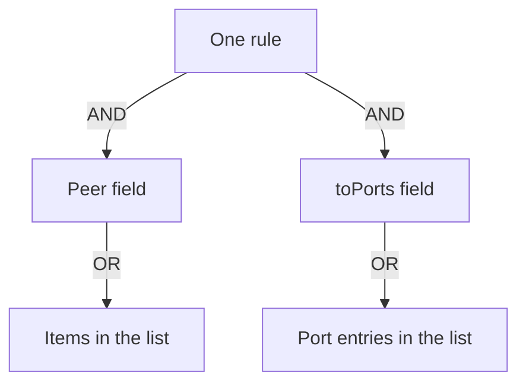

# Ports And Rule Combination

A peer selector says who. Ports say over which protocol and to which port. Most policies combine both, and several policies often select the same endpoint. This part covers the port fields and then the rules for combining fields, rules and policies.

## The toPorts field

The field `toPorts` is a list. Each item has `ports`, a list of port entries, and optionally `rules` for Layer 7 and `serverNames` for TLS names. Each port entry has a `port`, which is a string, an optional `endPort`, and a `protocol`.

```yaml
toPorts:
- ports:
  - port: "8080"
    protocol: TCP
  - port: "9000"
    endPort: 9100
    protocol: TCP
```

The first entry allows TCP port 8080. The second entry allows TCP ports 9000 to 9100, because `endPort` ends the range. The protocol can be `TCP`, `UDP`, `SCTP` or `ANY`. The default is `ANY`, which allows TCP, UDP and SCTP on that port. A rule for a service that uses TCP should name `TCP`, to keep the rule narrow.

The `toPorts` field is used in ingress rules as well, even though its name starts with `to`. In an ingress rule, the ports are the destination ports on the subject.

## A rule without ports

A rule without `toPorts` allows all ports and protocols for its peers. A rule with only `toPorts` and no peer field allows those ports from every peer. Both forms are common mistakes when an author meant a narrower rule. Read each rule for the fields that it does not contain.

## ICMP

The field `icmps` allows ICMP messages, such as echo requests. Each entry names a `type` and a `family`, `IPv4` or `IPv6`. ICMP does not use ports, so `toPorts` cannot express it.

## How fields combine

Inside one rule, all fields must match. A request must match the peer field and the port field. A rule with `fromEndpoints` for `shuttle` and `toPorts` for 8080 allows only `shuttle` on 8080.

Inside one list, any item may match. Two items in `fromEndpoints` allow the sources of both. Two items in `toPorts` allow the ports of both. Two ports in one `ports` list allow both.



The drawing shows that the fields of one rule are joined with AND, and the items inside each list are joined with OR.

## How rules and policies combine

Several rules in one `ingress` list add up: a request that matches any rule is allowed. Several policies that select the same endpoint add up in the same way. The allowed set is the union of all allow rules, and a rule can only add permissions.

A rule cannot subtract from another rule. To subtract, use a deny rule, which takes precedence. Two allow rules never cancel each other.

## A worked example

Take two ingress rules for the `probe` pods. The first allows `app: shuttle` on TCP 8080. The second allows the namespace `outpost`, all pods in it, on TCP 8080 and 9000.

The effective set has three statements. `shuttle` may use TCP 8080. Any pod of `outpost` may use TCP 8080. Any pod of `outpost` may use TCP 9000. A request from `shuttle` to port 9000 matches no statement, and it is dropped. A request from `drifter` to port 8080 matches the second rule and it is allowed.

## Checking a port rule on a running cluster

The agent shows the realized port rules per endpoint. The command `cilium-dbg endpoint get <ENDPOINT_ID>` prints the endpoint with its policy status, and the `realized` section holds the L4 rules per direction. Compare them with your intent. A port in the realized list that you did not write comes from another policy that selects the endpoint.

## Failure cases

A typical failure is a port written as a number instead of a string. The field `port` is a string, and the API server rejects a number in a CiliumNetworkPolicy. Another failure is the named port: Cilium accepts a named port from the container definition, and a typo in the name matches nothing.

A third failure is the protocol. A rule with `protocol: UDP` does not allow a TCP request to the same port, so a DNS request that falls back to TCP is dropped. A DNS rule should use `ANY` for port 53.

## Port rules and Services

A client usually calls a Service, and the Service forwards to a pod port. The policy checks the port of the pod, after the Service address is translated to a pod address. A rule must therefore name the container port that the pod listens on, which can differ from the port of the Service.

In the playground, the `probe` Service and the pod both use 8080, so the two numbers are the same. In a cluster where the Service port is 80 and the pod port is 8080, a rule for port 80 matches nothing.

## Reading order for ports

When you read a port rule, check three things in order: the protocol, the port or range, and the peer in the same rule. A port that appears in one rule is not allowed for the peers of a different rule.

## What this part showed

Ports are a list of entries with a protocol and an optional range. Fields in a rule are joined with AND, and list items are joined with OR. Rules and policies add up, and only a deny rule can remove an allow. The next part applies these rules in the playground.

## Common pitfalls

> [!WARNING]
> The port in a rule is a string, so write it in quotes. A rule without `toPorts` allows every port for its peers. A range needs both `port` and `endPort`, and the protocol applies to the whole range.
