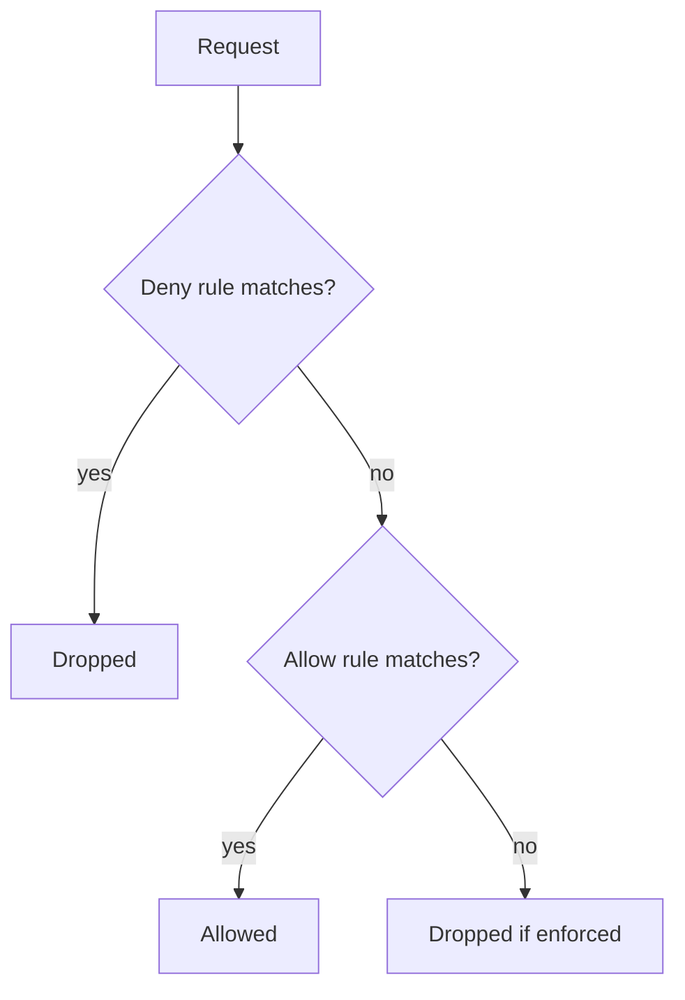

# Deny Rules And Precedence

Allow rules only add permissions. Some requirements need the opposite: everything in the cluster may call a service except one client. Writing an allow list of all other clients is long and breaks when a new client appears. Deny rules solve this by removing access from a broad allow. This part explains how deny rules are written and how Cilium resolves a conflict.

## The deny fields

A policy has `ingressDeny` and `egressDeny` lists next to `ingress` and `egress`. A deny rule has the same peer fields as an allow rule, such as `fromEndpoints`, `fromEntities` and `fromCIDR`, and it can have `toPorts` with ports and protocols. A deny rule drops matching traffic.

The next policy has one allow rule for the entity `cluster` on TCP 8080 and one deny rule for the `drifter` pods of `outpost`.

```yaml
spec:
  endpointSelector:
    matchLabels:
      app: probe
  ingress:
  - fromEntities:
    - cluster
    toPorts:
    - ports:
      - port: "8080"
        protocol: TCP
  ingressDeny:
  - fromEndpoints:
    - matchLabels:
        app: drifter
        k8s:io.kubernetes.pod.namespace: outpost
```

## Deny wins

A deny rule takes precedence over every allow rule. This holds across policy kinds: a deny in a CiliumNetworkPolicy beats an allow in a CiliumClusterwideNetworkPolicy, and a deny in a CiliumClusterwideNetworkPolicy beats an allow in a Kubernetes NetworkPolicy. No allow rule can restore traffic that a deny rule drops.

The result for a request is a short chain of checks. First, does any deny rule match the request? If so, it is dropped. If not, does any allow rule match? If so, it is allowed. If not, and the endpoint has enforcement on for that direction, it is dropped.



The drawing shows the order of the checks: deny first, then allow, and a default drop for an enforced endpoint.

## A deny policy also turns on enforcement

A pod enters default deny for a direction as soon as one policy selects it with a section for that direction. This is true for deny policies too. A policy with only an `ingressDeny` section puts its subject into default deny for ingress, so every request that no allow rule matches is dropped. To avoid that effect, a deny policy for a pod that has no allow policy needs an allow rule next to it, or the `enableDefaultDeny` field set to `false`.

## Apply the deny policy

Renew the playground and connect. Then apply the policy that allows the cluster and denies `drifter`.

<!-- astrona:playground:renew -->

```sh
export KUBECONFIG="$(astrona kubeconfig ats-053-playground-040-02)"
kubectl config current-context
```

Save this as `ciliumnetworkpolicy-cluster-with-deny.yaml`:

```yaml
apiVersion: cilium.io/v2
kind: CiliumNetworkPolicy
metadata:
  name: cluster-with-deny
  namespace: starfleet
spec:
  endpointSelector:
    matchLabels:
      app: probe
  ingress:
  - fromEntities:
    - cluster
    toPorts:
    - ports:
      - port: "8080"
        protocol: TCP
  ingressDeny:
  - fromEndpoints:
    - matchLabels:
        app: drifter
        k8s:io.kubernetes.pod.namespace: outpost
```

Apply it:

```sh
kubectl apply -f ciliumnetworkpolicy-cluster-with-deny.yaml
```

Then check the result. The request from `shuttle` prints `probe-ready`, because the entity `cluster` allows it. The request from `drifter` times out, although the entity `cluster` also includes it, because the deny rule wins.

```sh
kubectl -n starfleet exec shuttle -- python -c "import urllib.request; print(urllib.request.urlopen('http://probe.starfleet.svc:8080/',timeout=4).read().decode())"
kubectl -n outpost exec drifter -- python -c "import urllib.request; urllib.request.urlopen('http://probe.starfleet.svc:8080/',timeout=3).read()"
```

The second command ends with an error that contains `timed out`.

## Limits of deny rules

Deny rules do not support Layer 7. A deny rule cannot name an HTTP path, and it cannot use `toFQDNs` to deny a domain name. A requirement such as "block this URL" needs an allow rule with HTTP rules that leaves the URL out. A requirement such as "block this address range" can use `toCIDR` in an egress deny.

A deny rule also works only on identities and addresses that the datapath knows. A deny for a label set works for the pods with those labels, and a new pod that gets the labels is denied at once. A pod without the labels is not denied.

## Combining the rules in practice

Use allow rules for what a workload needs, and use deny rules for exceptions that must hold whatever other teams add. A clusterwide deny for an untrusted entity, such as `world` into every namespace, is a common guard. It stays valid when a team later adds a broad allow rule by mistake.

## What this part showed

Deny rules are written in `ingressDeny` and `egressDeny`, and they win over every allow rule of every policy kind. A deny policy also turns on enforcement for its subject. Deny rules have no Layer 7 support, so a path or a domain name cannot be denied directly.

## Common pitfalls

> [!WARNING]
> A deny rule cannot be overridden by an allow rule in any policy. A policy with only deny rules still puts its subject into default deny for that direction. Do not use a deny rule for an HTTP path or a domain name, because Layer 7 deny is not supported.
