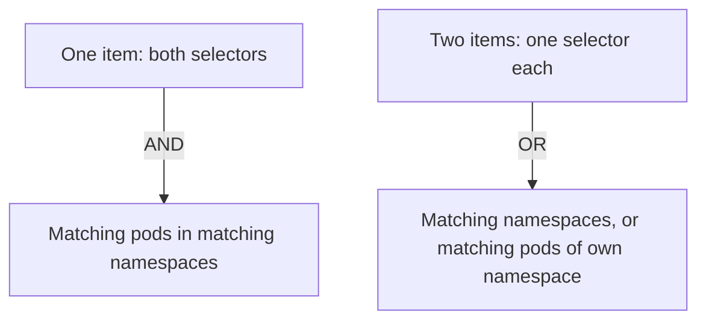

# The NetworkPolicy API

Every Kubernetes cluster has the same NetworkPolicy resource, whatever network plugin runs underneath. A team can write a policy once and move it between clusters. This part explains what the resource contains and which rules decide the result, so that a NetworkPolicy can be read the same way as a Cilium policy.

## One resource, many implementations

The NetworkPolicy resource belongs to the API group `networking.k8s.io/v1`. The Kubernetes API server stores it, but the API server does not enforce it. The network plugin enforces it. A cluster whose plugin does not support NetworkPolicy accepts the objects and ignores them. Cilium supports NetworkPolicy, so the agents enforce it.

## The fields

A NetworkPolicy is namespaced. The field `spec.podSelector` selects the subject pods in the namespace of the policy. An empty selector selects every pod of the namespace.

The field `policyTypes` lists `Ingress`, `Egress` or both. It decides which directions the policy covers. When the field is omitted, `Ingress` is always included, and `Egress` is included only if the policy has an `egress` section.

The lists `ingress` and `egress` hold allow rules. An ingress rule has `from`, a list of peers, and `ports`. An egress rule has `to` and `ports`. A peer is one of three forms: a `podSelector`, a `namespaceSelector`, or an `ipBlock`.

```yaml
spec:
  podSelector:
    matchLabels:
      app: probe
  policyTypes:
  - Ingress
  ingress:
  - from:
    - namespaceSelector:
        matchLabels:
          kubernetes.io/metadata.name: outpost
      podSelector:
        matchLabels:
          app: drifter
    ports:
    - port: 8080
      protocol: TCP
```

This policy selects the `probe` pods and allows ingress from the pod `app: drifter` in the namespace `outpost` on TCP 8080. The two selectors in one peer item are joined with AND, so the peer is a `drifter` pod in `outpost`.

## The two ways to combine selectors

The difference between one peer item with two selectors and two peer items is a classic trap. In one item, `namespaceSelector` and `podSelector` together mean pods that match the pod selector in the namespaces that match the namespace selector. In two items, they mean any pod in the matched namespaces, or the matched pods in the namespace of the policy.



The drawing shows that two selectors in one item narrow the peer, and two items add two peers.

## ipBlock

The `ipBlock` peer selects a range of addresses with an optional `except` list. It is meant for addresses outside the cluster. Pod addresses are not stable and the API says that the pod addresses should not be used in an `ipBlock`.

## Ports

The `ports` field holds entries with a `port`, an optional `endPort` and a `protocol`. The `port` is a number or a named port, and it is written without quotes for a number. The protocol defaults to TCP. A rule without `ports` allows all ports for its peers, and a rule without a peer list allows all peers on the listed ports.

## Default deny by selection

A pod that no NetworkPolicy selects accepts all traffic. A pod that a policy selects for a direction accepts only what the union of the allow rules of all selecting policies permits for that direction. The result is the same flag model that Cilium policies use.

An empty `ingress` list is a rule set that allows nothing. A policy with `podSelector: {}`, `policyTypes: [Ingress]` and no `ingress` field therefore denies all ingress to all pods of its namespace. This is the standard default deny policy.

## No deny rules, no order

The NetworkPolicy API has no deny rule and no rule order. Policies only add allows. To block one client while allowing the rest, a NetworkPolicy author must list all other clients in the allow rules. This is the main design limit of the API, and it is the reason why plugins add their own policy kinds.

## Namespace selection by label

A `namespaceSelector` matches the labels of namespaces, not of pods. Kubernetes sets the label `kubernetes.io/metadata.name` on every namespace, with the namespace name as value. A selector on this label is the portable way to select one namespace by name.

An empty `namespaceSelector` matches every namespace. A peer with only a `podSelector` matches pods in the namespace of the policy only.

## What the API does not cover

The standard API does not have Layer 7 rules, names for external destinations, entities such as the node or the API server, cluster scope, deny rules or audit settings. A policy that needs one of these features uses the plugin's own resource.

## What this part showed

A NetworkPolicy selects subject pods, lists the directions in `policyTypes`, and allows peers and ports. Selectors in one peer item are joined with AND, and items are joined with OR. Policies add allows and cannot deny. The next part explains how Cilium enforces these rules.

## Common pitfalls

> [!WARNING]
> Two selectors in one peer item and two items with one selector each mean different things. A numeric port is written without quotes in a NetworkPolicy, unlike in a Cilium policy. An `ipBlock` is not a reliable way to select pods.
