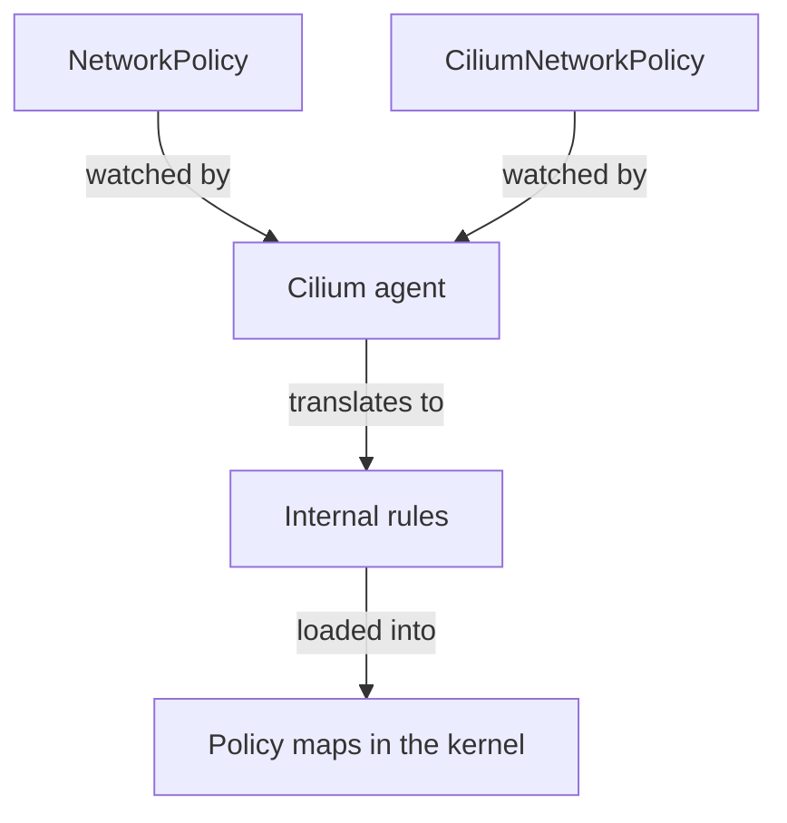

# How Cilium Enforces NetworkPolicy

A policy resource is only a statement of intent. Something must turn it into packet decisions. This part explains what Cilium does with a NetworkPolicy, what stays the same as for Cilium's own policies, and where the standard API is limiting.

## The agent translates the policy

Each Cilium agent watches NetworkPolicy objects through the Kubernetes API. When a policy selects a local pod, the agent translates the policy into the same internal rule format that it uses for a CiliumNetworkPolicy. The pod selector becomes an endpoint selector. The `from` and `to` peers become sets of identities. The ports become entries in the policy map of the endpoint.

After the translation, the datapath does not know which kind of resource a rule came from. The enforcement flags, the identity lookups and the policy maps work as described for Cilium policies. A NetworkPolicy that selects a pod for ingress turns on ingress enforcement for that pod, and its egress flag stays unchanged.

## Peers become identities

A `podSelector` peer becomes the identities whose labels match in the namespace of the policy. A `namespaceSelector` peer becomes the identities of pods in the matching namespaces. When both selectors are in one item, Cilium applies both conditions.

An `ipBlock` peer becomes a CIDR rule, and the agent allocates identities for the ranges, as for a CiliumNetworkPolicy CIDR rule. The datapath uses the same IP-to-identity map.

The drawing shows that both resource kinds feed the same agent, which turns them into one rule format and loads them into the kernel.

## The union of both kinds

A pod can be selected by NetworkPolicy objects and by Cilium policies at the same time. The allowed set for each direction is the union of all allow rules from all kinds. A NetworkPolicy that allows `shuttle`, plus a CiliumNetworkPolicy that allows `drifter`, together allow both.

This is the property that lets a team extend an existing NetworkPolicy without editing it. A new Cilium policy that selects the same pods adds its rules, and the existing object stays as it is. The reverse also holds: a broad Cilium allow rule can make a strict NetworkPolicy less strict than its author thinks.

## Where the Kubernetes API is limiting

The NetworkPolicy API cannot express several things that production clusters need. It has no Layer 7 rules, so it cannot allow one HTTP path. It has no name-based egress, so allowing a destination by domain name needs a Cilium policy. It has no entities, so selecting the node or the API server needs `ipBlock` guesses or a Cilium policy.

It has no deny rules. It has no cluster scope, so a rule that applies to all namespaces needs a policy object in each namespace. It has no audit mode and no per-direction control of default deny. Each of these limits is a reason to use a Cilium policy next to or instead of the standard resource.

## What stays portable

A NetworkPolicy is portable because it uses only the standard fields. A team that must run on several plugins can keep the base rules, such as default deny and namespace isolation, in NetworkPolicy objects. Features that only Cilium supports then sit in Cilium objects that other plugins ignore.

The risk of a split is a surprise when a cluster does not run Cilium: the Cilium objects have no effect, and the base policies alone decide. The team must test the base policies without the extensions.

## Egress and the policy types

For a NetworkPolicy with `Egress` in `policyTypes`, the agent turns on egress enforcement for the selected pods. The `to` peers become destination identities or CIDR ranges, and the ports become destination port entries. The same effect as in Cilium policies follows: a pod with egress enforcement and no rule for the DNS service cannot look up names.

A NetworkPolicy author must therefore add an egress rule for the DNS pods, with port 53 on UDP and TCP, as part of every egress policy. Cilium does not add an implicit DNS exception for either policy kind.

## Policy order and conflicts

There is no order among policies. The agent does not evaluate them one after the other, and the first match does not stop the check. It computes the full allowed set for each direction from all selecting policies, and the datapath looks the flow up in that set.

Because of this, two NetworkPolicy objects that overlap do not conflict. The overlap only widens the allowed set. The only way to create a conflict is a Cilium deny rule, which wins over every allow rule of every kind.

## Behaviour that Cilium adds

Cilium adds behaviour that the standard does not define. Traffic from the local node to local pods is allowed by default, so health probes from the kubelet keep working under a NetworkPolicy. A cluster can switch this default off with an agent setting.

Traffic to and from the Kubernetes API server and other cluster services also needs rules like any other traffic, unless a policy kind with entities allows it. For this case the standard API has only the `ipBlock` form.

## A worked example of the union

Take a NetworkPolicy that allows ingress to `probe` from the namespace `starfleet` on TCP 8080. Add a CiliumNetworkPolicy that allows ingress to `probe` from every pod on TCP 9000. The effective allowed set has two statements: pods of `starfleet` on 8080, and every pod on 9000. Neither policy removed anything from the other.

Add a third object, a CiliumClusterwideNetworkPolicy with an `ingressDeny` rule for `app: drifter`. The `drifter` pod is now dropped on both ports, even though the second statement allows every pod on 9000.

## Inspecting what the agent made of it

The agent lists policies it holds with `cilium-dbg policy get`. A NetworkPolicy appears there as a rule with labels that name the resource kind, the name and the namespace. The endpoint view shows the same labels in the `derived-from-rules` list of the realized rules. Use them to find out which objects shape the enforcement of one pod.

## Failure cases

A frequent failure is a NetworkPolicy that is correct but does not take effect because the agent has not synchronised yet. Check the endpoint list for the enforcement flag before changing the policy.

Another failure is an unexpected allow: two policies of different kinds select the same pod, and the union is wider than either author intended. List every policy that selects the pod, of both kinds, before concluding that a rule is wrong.

## What this part showed

Cilium watches NetworkPolicy objects and translates them to the same rules, identities and flags as its own policy kinds. Both kinds add up in a union. The standard API lacks Layer 7, names, entities, deny, cluster scope and audit, and a Cilium policy fills those gaps.

## Common pitfalls

> [!WARNING]
> A NetworkPolicy and a CiliumNetworkPolicy on the same pods are combined by union, so the broader one wins for allows. Check both kinds when you debug. Cilium objects have no effect on a cluster that does not run Cilium.
