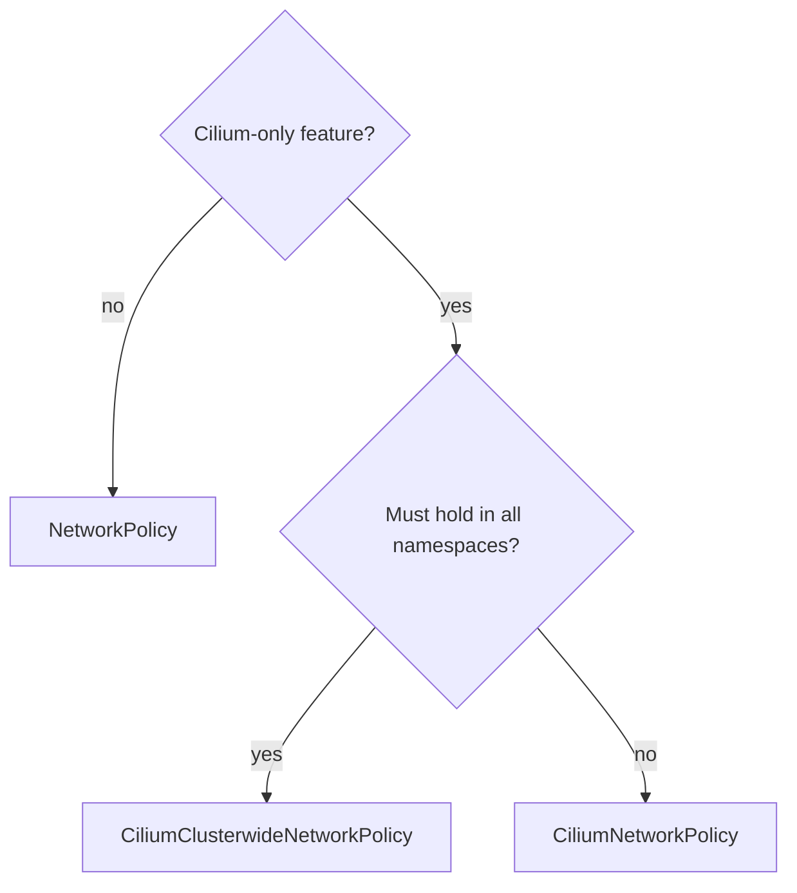

# Choosing A Policy Kind And Migrating

A cluster with three policy kinds needs a rule for which kind to use when. Without a rule, teams mix the kinds at random, and nobody can say what is allowed for a pod. This part gives a way to choose a kind for a requirement, compares the kinds, and describes a safe migration.

## Compare the kinds

The three kinds differ in scope, portability and features. The comparison below is the one to use when you decide.

- Kubernetes NetworkPolicy: namespaced, portable between network plugins, allow rules only, no Layer 7, no names, no entities, no deny.
- CiliumNetworkPolicy: namespaced, works only with Cilium, has entities, Layer 7, names, deny and `enableDefaultDeny`.
- CiliumClusterwideNetworkPolicy: cluster scope, works only with Cilium, has the same features, and can select nodes with `nodeSelector`.

## A decision order

Ask four questions in order. First, does the requirement need a Cilium-only feature, such as Layer 7, names, entities, deny or default deny control? If yes, use a Cilium kind. Second, does the rule have to hold in every namespace, or must teams not be able to edit it? If yes, use the clusterwide kind. Third, does the policy have to run on other network plugins as well? If yes, keep the base rules in NetworkPolicy and add Cilium objects only for the extras. Fourth, if none of these applies, use a NetworkPolicy, because it is the most portable.



The drawing shows the decision: a requirement without a Cilium-only feature stays in a NetworkPolicy, and one with such a feature goes to a Cilium kind chosen by scope.

## Examples of choices

A rule that allows the `shuttle` pod to reach `probe` on TCP 8080 needs nothing special, so it fits a NetworkPolicy. A rule that allows only `GET /public` needs Layer 7, so it needs a CiliumNetworkPolicy. A rule that blocks the `world` entity from every namespace needs deny and cluster scope, so it needs a CiliumClusterwideNetworkPolicy. A rule that allows egress to an external API by its name needs `toFQDNs`, so it needs a Cilium kind.

## Check the combined result

When several kinds select one pod, the allowed set is the union of all allow rules, and deny rules remove traffic from it. A review of a pod therefore lists every object of every kind that selects it. The agent helps: `cilium-dbg endpoint get <ENDPOINT_ID>` shows the realized rules with the labels of the objects they came from.

Renew the playground and connect, then read the realized ingress rule sources of the `probe` endpoint on the agent of its node. Replace the placeholders with the agent pod name and the endpoint number from the endpoint list.

<!-- astrona:playground:renew -->

```sh
export KUBECONFIG="$(astrona kubeconfig ats-053-playground-050-02)"
kubectl -n kube-system exec <AGENT_POD> -- cilium-dbg endpoint list
kubectl -n kube-system exec <AGENT_POD> -- cilium-dbg endpoint get <ENDPOINT_ID> -o jsonpath='{range ..status.policy.realized.l4.ingress[*].derived-from-rules}{@}{"\n"}{end}'
```

If both a NetworkPolicy and a Cilium policy select the endpoint, lines for both kinds appear. If a policy you expect is missing, the agent did not select the endpoint with it.

## Migrating from NetworkPolicy to Cilium kinds

A migration has risk, because the same rule in a new kind must behave the same. A safe order is as follows. First, list all NetworkPolicy objects and what each allows. Second, write the Cilium equivalent for the rules that need Cilium features. Third, apply the new object next to the old one, which changes nothing for allows because the union is the same. Fourth, remove the old object only after the new one is verified. Fifth, test the dropped requests as well as the allowed ones.

Applying the new object first is safe, because the union only grows. Removing the old object first is not safe, because there is a gap in which traffic is dropped.

## Migrating to default deny

To move a namespace to default deny, add an allow rule for each known flow before the deny. For a NetworkPolicy, the deny is an empty pod selector with no ingress rules. For a Cilium policy, it is an empty endpoint selector with an empty ingress rule list. Use audit mode or `enableDefaultDeny` set to `false` to observe the flows first.

## Failure cases in a mixed setup

A mixed setup has typical faults. A NetworkPolicy and a Cilium policy both allow the same flow, and an author removes one of them and expects the flow to stop. The flow continues because the other object still allows it. Check all objects that select the pod before you conclude that a removal worked.

A second fault is a clusterwide deny that an application team does not know about. A request is dropped, the team sees no policy in its namespace that explains it, and it loses time. A shared note on the clusterwide guards, and drop events that name the policy, shorten that search.

A third fault is a rule that was moved to a Cilium kind but still depends on a portable behaviour that the Cilium kind does not have in the same form, such as a named port. Test each moved rule with an allowed and a dropped request.

## Naming and ownership

Give each policy a name that states its subject and its purpose, such as `probe-allow-clients`. Record the owner in the `description` field of Cilium objects and in an annotation of NetworkPolicy objects. When an object has no known owner, nobody dares to remove it, and the allowed set only grows.

## Reviewing on a schedule

Review the full list of policies of all three kinds on a schedule. Remove objects that no workload needs any more, and merge objects that repeat each other. A shorter list is easier to reason about, and it has fewer ways to widen the allowed set by accident.

## Keeping the setup understandable

Document which kind carries which rule. A convention such as "baseline and namespace isolation in NetworkPolicy, extras in Cilium objects, cluster guards in clusterwide objects" lets a new team member find a rule quickly. Use the `description` field and consistent object names.

Record the reason next to each Cilium-only object. A reviewer then knows whether the object exists for Layer 7, for deny or for cluster scope, and knows when it can be removed.

## What this part showed

The kinds differ in scope, portability and features. A short decision order picks the kind: Cilium-only feature, cluster scope, portability. A migration adds the new object first and removes the old one last, and the agent can list the objects that shape each endpoint.

## Common pitfalls

> [!WARNING]
> Do not remove the old policy before the new one is verified, because there is a gap in which traffic is dropped. A clusterwide object is wider than it looks, so review its selector twice. A rule that needs Layer 7 does nothing in a NetworkPolicy, because the standard API has no such field.
